# Clinical Notes Analyzer

A serverless pipeline on AWS that removes personal details from clinical notes, extracts conditions, medications and dosages, stores the de-identified results, and sends an alert when a note mentions something high risk. Everything runs inside a private VPC with no internet access and is built with Terraform.

All data is synthetic. The design follows healthcare security practices such as those expected under Ontario's PHIPA, but this is a portfolio project and is not certified as compliant.

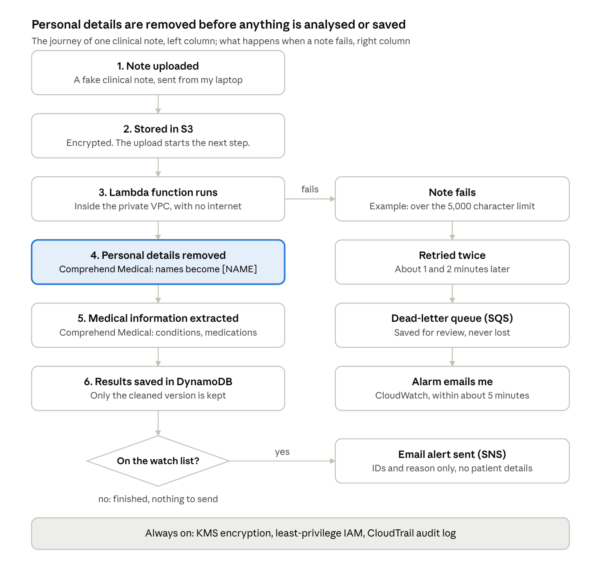

## How it works

1. A note is uploaded to an encrypted S3 bucket at `notes/<patient_id>/<note_id>.txt`.
2. The upload triggers a Lambda function running in private subnets with no internet access. It reaches AWS services through VPC endpoints.
3. Notes over 5,000 characters are rejected before any paid call, to keep costs predictable.
4. Comprehend Medical **DetectPHI** finds names, ages, places, dates and phone numbers, and they are replaced with tags like `[NAME]`.
5. **DetectEntitiesV2** extracts conditions, medications, dosages and tests from the de-identified text.
6. Results are saved to DynamoDB. The raw note text never appears in logs.
7. If a watched condition or medication appears, an email alert is sent through SNS with only the IDs and reason. Negated findings ("denies chest pain") are ignored.
8. A note that fails 3 times goes to an SQS dead-letter queue, and CloudWatch alarms send an email.

## Tech stack

| Area | Services |
| --- | --- |
| Infrastructure as code | Terraform (6 modules, 47 resources) |
| Compute | AWS Lambda (Python 3.12) |
| AI | Amazon Comprehend Medical |
| Storage | Amazon S3, Amazon DynamoDB |
| Networking | Amazon VPC, gateway and interface VPC endpoints |
| Messaging | Amazon SNS, Amazon SQS |
| Security | AWS KMS, AWS IAM, AWS CloudTrail |
| Monitoring | Amazon CloudWatch alarms and logs |

## Security decisions

- **No internet access.** Private subnets only, with no internet gateway or NAT gateway. AWS services are reached through VPC endpoints, which also avoids a NAT gateway's cost of about $35 a month.
- **Raw notes stay inside the VPC.** The bucket policy refuses to return a note unless the request comes through the project's S3 VPC endpoint, so even an account admin can't download one from the internet. Uploads still work.
- **Two independent locks.** Endpoint policies restrict what can travel through each private connection (read notes, write results, publish to one topic), on top of the IAM role.
- **Least privilege.** Lambda can read only `notes/*`, write only to its table, publish only to its topic, and write only to its own log group.
- **Encryption everywhere.** One customer-managed KMS key with rotation encrypts S3, DynamoDB, SNS and Lambda's environment variables. HTTPS is required for all bucket access.
- **De-identify before analysis.** Personal details are removed before clinical extraction, and only de-identified results are stored.
- **No patient data in logs or emails.** Logs record IDs and counts only. Alerts contain the IDs and the reason.
- **Short retention.** Raw notes expire after 30 days. Audit logs expire after 30 days.
- **Audit trail.** CloudTrail records account activity and every upload or read of a clinical note, with log file validation so tampering can be detected.
- **Nothing silently lost.** Failed notes retry twice, then go to an encrypted dead-letter queue, and alarms send an email.

## Test data

Three short hand-written synthetic notes, each labelled "SYNTHETIC TEST NOTE - NOT A REAL PATIENT", plus one note that is too long on purpose. Each was designed to test a different case.

| Note | Contents | What it tests | Result |
| --- | --- | --- | --- |
| patient-001 | Atrial fibrillation, on warfarin. Also "denies chest pain". | High-risk medication, and that negated findings are ignored | Flagged for warfarin only |
| patient-002 | Seasonal allergies, includes a phone number | A normal note | Not flagged |
| patient-003 | Chest pain in the emergency department, given heparin | Serious symptom plus high-risk medication | Flagged for chest pain and heparin |
| `samples/fail/too-long.txt` | 6,000 characters | Failure path and cost limit | Rejected 3 times, moved to the dead-letter queue |

**Before and after (patient-003, line 2):**

| Before | After |
| --- | --- |
| Patient: Priya Raman, 58 y/o female, seen in ED on 2026-10-18. | Patient: [NAME], [AGE] y/o female, seen in [ADDRESS] on [DATE]. |

The clinical lines are unchanged. Note that "ED" (emergency department) was tagged as an address. Over-redacting is the safer mistake, but it shows the model isn't perfect, which is why a production system would add human review for low-confidence results.

## Results

Tested end to end on November 12, 2026, then torn down with `terraform destroy`.

| Test | Result |
| --- | --- |
| Build | 47 resources created with `terraform apply` |
| Process 3 notes | 2 flagged correctly, 1 not flagged, 2 alert emails |
| De-identification | Name, age, place and date replaced with tags |
| Download a note from outside the VPC | Refused with 403 Forbidden, even with admin permissions |
| Note over 5,000 characters | Rejected, retried twice about 1 and 2 minutes apart, then moved to the dead-letter queue |
| Alarms | Errors and dead-letter alarms fired; throttling and slow-run alarms stayed OK |
| Audit trail | CloudTrail log files and a digest file delivered |
| Cost | About $0.20 for the full test session |

### Screenshots

**Results for the three notes, then a refused download from outside the VPC**

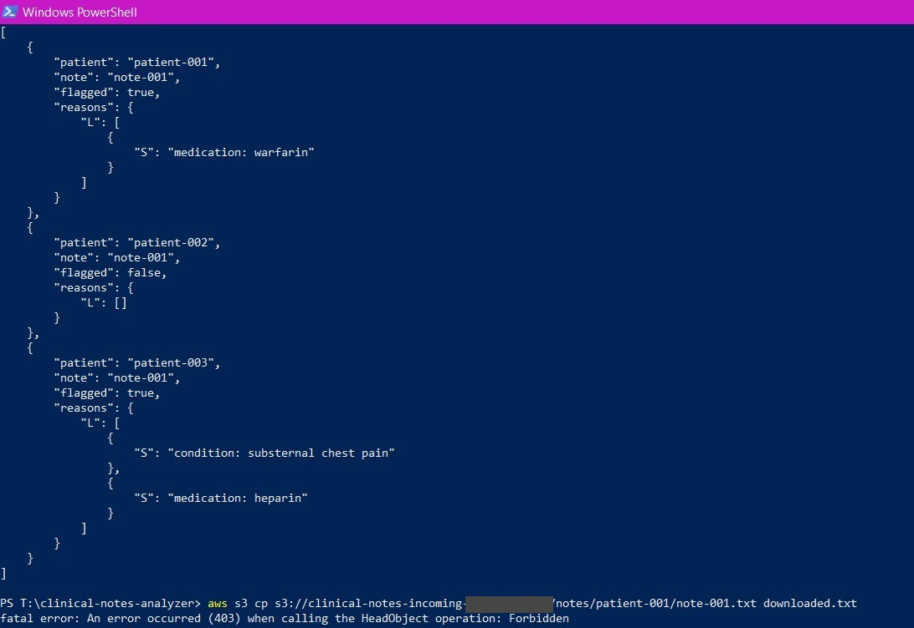

**Alert email: IDs and reason only**

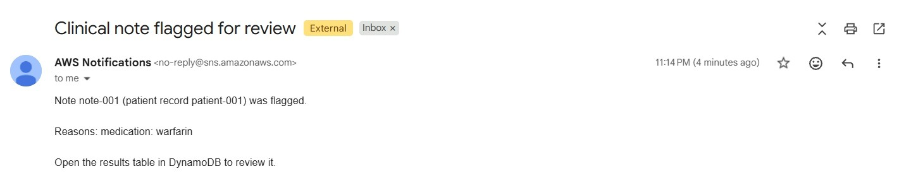

**Results table in DynamoDB**

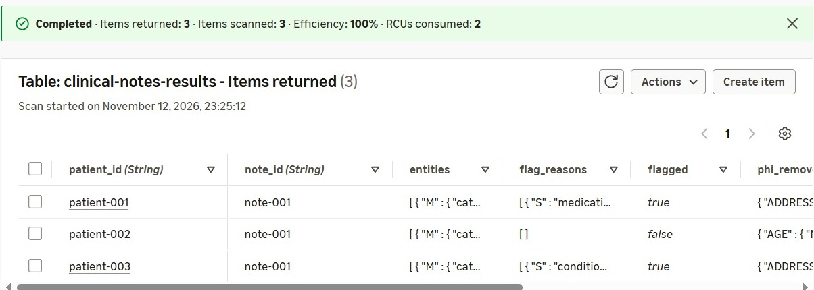

**Saved note with personal details replaced by tags**

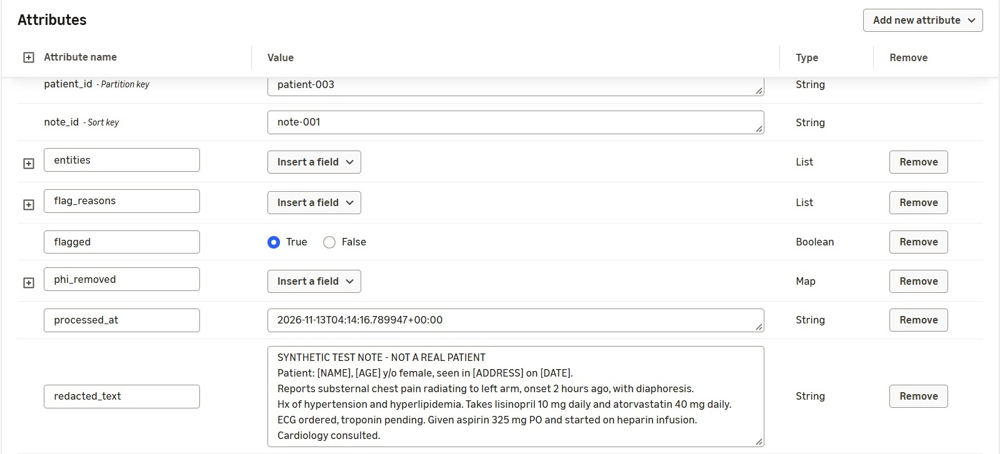

**The too-long note rejected three times**

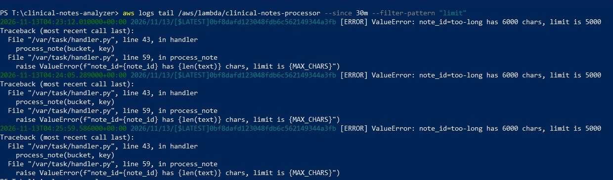

**The failed note kept in the dead-letter queue** (account identifiers and IP address hidden)

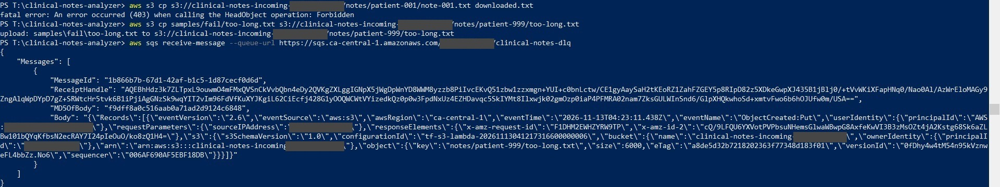

**Alarm email**

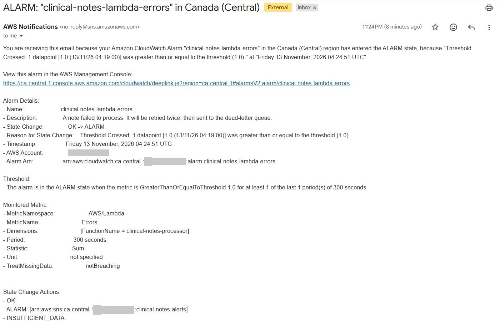

**CloudWatch alarms: two fired, two stayed OK**

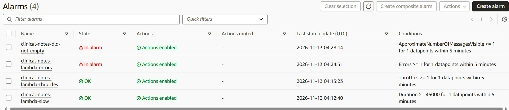

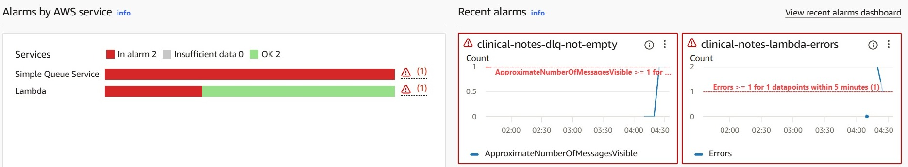

**CloudTrail audit log files and digest**

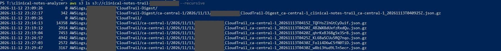

**The four VPC endpoints**

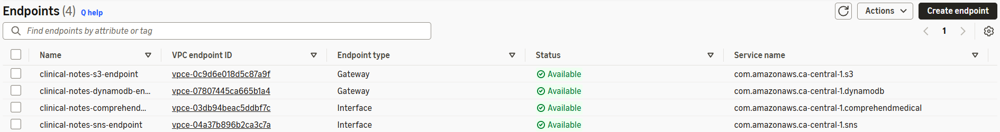

**Everything deleted afterwards**

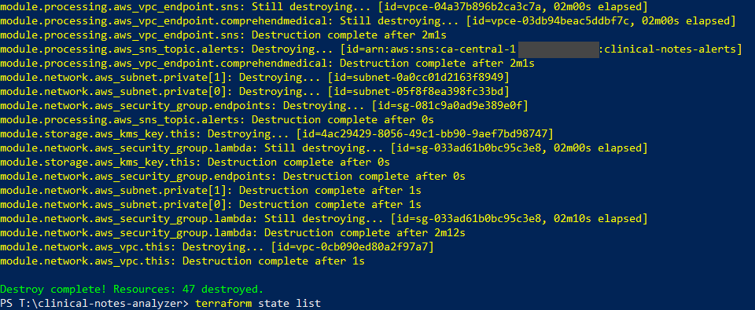

## Project structure

```
.
├── main.tf              # wires the modules together
├── lockdown.tf          # gateway endpoint policies
├── variables.tf, outputs.tf, versions.tf
├── lambda/handler.py    # the note processor
├── modules/
│   ├── network/         # VPC, private subnets, security groups, S3 and DynamoDB endpoints
│   ├── storage/         # KMS key, S3 bucket, DynamoDB table
│   ├── processing/      # Lambda, Comprehend Medical and SNS endpoints, alerts, dead-letter queue
│   ├── audit/           # CloudTrail and its log bucket
│   └── monitoring/      # CloudWatch alarms
├── samples/             # synthetic test notes
└── docs/screenshots/
```

## Running it

### Prerequisites

1. The AWS CLI and Terraform installed.
2. A non-root identity: ideally IAM Identity Center (`aws configure sso`), or an IAM user with an access key (`aws configure`). Check it with `aws sts get-caller-identity`.
3. A monthly cost budget with email alerts, created in the AWS console (Billing > Budgets). It is kept out of Terraform on purpose so it keeps watching after `terraform destroy`.

### Deploy

```bash
cp terraform.tfvars.example terraform.tfvars   # then put your email in it
terraform init
terraform plan      # read this before applying
terraform apply
```

Click the "AWS Notification - Subscription Confirmation" link AWS emails you. The SNS topic is new after every apply, so this is needed every time, or no alerts or alarms will arrive.

### Test

Commands below are PowerShell. In bash, the same commands work as written.

```powershell
# Process the sample notes
aws s3 cp samples/notes "s3://$(terraform output -raw incoming_bucket)/notes/" --recursive
aws dynamodb scan --table-name clinical-notes-results --query "Items[].{patient:patient_id.S,note:note_id.S,flagged:flagged.BOOL,reasons:flag_reasons}" --output json

# This should fail with 403 Forbidden
aws s3 cp "s3://$(terraform output -raw incoming_bucket)/notes/patient-001/note-001.txt" downloaded.txt

# Dead-letter queue test (no Comprehend Medical charge)
aws s3 cp samples/fail/too-long.txt "s3://$(terraform output -raw incoming_bucket)/notes/patient-999/too-long.txt"
# wait about 5 minutes
aws sqs receive-message --queue-url (terraform output -raw dlq_url)
aws logs tail /aws/lambda/clinical-notes-processor --since 30m --filter-pattern "limit"

# Alarms and audit trail
aws cloudwatch describe-alarms --alarm-name-prefix clinical-notes --query "MetricAlarms[].{name:AlarmName,state:StateValue}" --output table
aws s3 ls "s3://$(terraform output -raw trail_bucket)" --recursive
```

### Tear down when you're done

```bash
terraform destroy
terraform state list   # should print nothing
```

Destroying a Lambda function that runs inside a VPC can take 10 to 30 minutes while AWS removes its network interfaces. This is normal. The KMS key stays in "pending deletion" for 7 days, then is removed automatically.

## Cost (ca-central-1)

| Item | Approx. cost |
| --- | --- |
| 2 interface endpoints (Comprehend Medical, SNS), in one subnet each | About $0.02 an hour, about $16 a month if never destroyed |
| KMS key | About $1 a month, charged by the hour |
| Comprehend Medical | About 4 to 5 cents per 400-character note |
| CloudTrail management events, 4 CloudWatch alarms | Free |
| CloudTrail S3 data events, S3, DynamoDB, Lambda, SNS, SQS | Fractions of a cent at this scale |

A full test session of about an hour, processing the three sample notes once, costs about 20 cents as long as it ends with `terraform destroy`.

## Limitations and next steps

- Synthetic data only. Real data would need legal agreements with AWS and approval from the organisation.
- Interface endpoints sit in one Availability Zone to halve their cost. Production would place them in every zone.
- Comprehend Medical can miss or over-redact details. Production would add a confidence threshold and human review.
- Comprehend Medical's endpoint has no endpoint policy; the IAM role limits it to the two detection calls.
- CloudWatch Logs use AWS-owned encryption, not the project key. They contain IDs and counts only.
- Single-region trail. Production would use an organisation-wide, multi-region trail in a separate audit account.
- Next: a GitHub Actions pipeline that runs `terraform fmt`, `validate` and `plan` on every push, using OIDC instead of stored keys.
